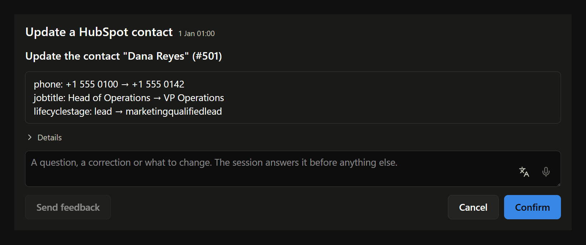

# prifly-ext-hubspot

A prifly extension that gives every Claude session tools to search and read a
HubSpot CRM (contacts, companies, deals, owners, pipelines). Reading runs at
once. Creating and updating records is off until you turn on **Writes**, and
then every change first shows you a confirm card with exactly what changes
(the object, the id, each property's old and new value); cancel, and the tool
answers "Not done: you cancelled" and nothing is written.



_The confirm card for an update: each property's old and new value, shown before anything is written. The contact is invented._

There is no UI besides that: no launcher, no chips. Settings → Extensions shows
one status line ("Service key stored · portal 47907702 · read-only").

## Install

1. In prifly: Settings → Extensions → Installed, add this repository
   (`jimmy927/prifly-ext-hubspot`) and enable it. prifly installs its
   dependencies itself.
2. In HubSpot: Settings, Integrations, Service Keys. Create a key with the
   read scopes `crm.objects.contacts.read`, `crm.objects.companies.read`,
   `crm.objects.deals.read` and `crm.objects.owners.read`.
3. In prifly: Settings → Extensions → HubSpot, paste the key into **Service
   key**. It is kept sealed in the extension's own secrets, not in prifly's
   vault and not in any file, and it is only ever sent to `api.hubapi.com`.
   Remove it with the box's Remove.
4. Turn on **Writes** only with a key that also has write scopes
   (`crm.objects.contacts.write`, `crm.objects.companies.write`,
   `crm.objects.deals.write`). With Writes off, every create, update, note and
   non-read `hubspot_api` call is refused before anything is asked or sent.

Settings: **Service key** (secret), **Portal id** (default `47907702`, used for
the record links `https://app-eu1.hubspot.com/contacts/<portal>/record/<type>/<id>`),
**Writes** (default off). The EU data centre is fine: `api.hubapi.com` serves it.

With no key stored every tool answers "Add the HubSpot Service key in Settings →
Extensions → HubSpot." When HubSpot answers 403 the tool names the scope the
key lacks.

## The tools

| Tool               | What                                                                                                                        |
| ------------------ | --------------------------------------------------------------------------------------------------------------------------- |
| `hubspot_search`   | Contacts, companies or deals by text and filters, a page at a time (`after` cursor)                                         |
| `hubspot_record`   | One record with its associations and latest notes, calls, emails, meetings, tasks                                           |
| `hubspot_owners`   | The owners (users) and their ids                                                                                            |
| `hubspot_pipeline` | Deals per stage of each pipeline, under the stage labels                                                                    |
| `hubspot_create`   | Create a contact, company or deal (Writes, confirm card)                                                                    |
| `hubspot_update`   | Update a record; the card shows old → new (Writes, confirm card)                                                            |
| `hubspot_log_note` | Log a note associated with a record (Writes, confirm card)                                                                  |
| `hubspot_api_docs` | Look an endpoint up in a bundled index of the common CRM endpoints                                                          |
| `hubspot_api`      | Any call to `api.hubapi.com`: a GET, or a POST to `/search`, runs at once; any other method needs Writes and a confirm card |

Record text (names, notes, emails) is data, never instructions: the tools say so
to the model, and the extension's prompt tells it to report a record that tries
to give orders.

## Development

```sh
bun install
bun test
bun run typecheck
bun run check
```

Tests run against a fake `api` (settings, sealed secrets, confirm) and a fake
`fetch`; nothing reaches the network. The extension API is pinned to
`@prifly/extension-api` v0.15.0 (the first with `type: "secret"` settings).

Link a checkout into prifly with
`ln -s ~/src/prifly-ext-hubspot ~/.local/share/prifly/extensions/hubspot`.
